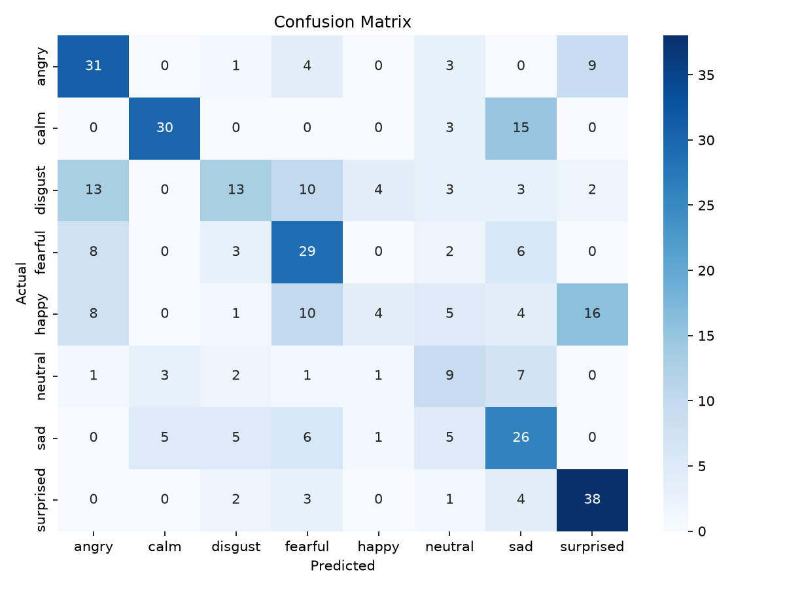
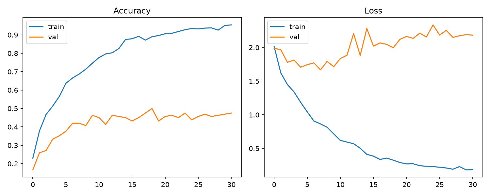

# CodeAlpha Emotion Recognition from Speech

A deep learning model that recognizes human emotions (angry, calm, disgust, fearful, happy, neutral, sad, surprised) from speech audio. Built for the **CodeAlpha Machine Learning Internship (Task 2)**.

## Objective
Given a short speech clip, predict which of 8 emotions the speaker is expressing, using speech signal processing and a Convolutional Neural Network (CNN).

## Dataset
**RAVDESS** (Ryerson Audio-Visual Database of Emotional Speech and Song), speech portion only.
- 1,440 audio clips from 24 professional actors (12 female, 12 male)
- 8 emotion classes
- Download: search "RAVDESS Emotional Speech Audio" on Kaggle
- The dataset is not included in this repository because of its size

Emotion labels are read from each filename. In `03-01-06-01-02-01-12.wav`, the third number is the emotion (01 neutral, 02 calm, 03 happy, 04 sad, 05 angry, 06 fearful, 07 disgust, 08 surprised) and the last number is the actor.

## Approach
1. **Feature extraction:** each clip is trimmed of silence and cut to 3 seconds. I extract **40 MFCCs** (Mel-Frequency Cepstral Coefficients) with `librosa`, giving a 130 x 40 feature matrix per clip.
2. **Normalization:** features are standardized using statistics from the training set only.
3. **Speaker-independent split:** actors 1 to 18 are used for training (1,080 clips) and actors 19 to 24 for testing (360 clips). The model is tested on voices it has never heard, which gives a more honest result than a random split.
4. **Model:** a 1D CNN with three Conv1D blocks (64, 128, 256 filters), each with Batch Normalization, Max Pooling, and Dropout, followed by Global Average Pooling and dense layers with a softmax output.
5. **Training:** Adam optimizer, up to 60 epochs, early stopping, and learning-rate reduction on plateau, with 15% of the training data used for validation.

## Results
| Metric | Value |
|---|---|
| Test accuracy (unseen speakers) | **50.0%** |
| Macro-average F1-score | 0.47 |
| Random-guess baseline (8 classes) | 12.5% |

Per-emotion performance (from the classification report):

| Emotion | Precision | Recall | F1-score |
|---|---|---|---|
| angry | 0.51 | 0.65 | 0.57 |
| calm | 0.79 | 0.62 | 0.70 |
| disgust | 0.48 | 0.27 | 0.35 |
| fearful | 0.46 | 0.60 | 0.52 |
| happy | 0.40 | 0.08 | 0.14 |
| neutral | 0.29 | 0.38 | 0.33 |
| sad | 0.40 | 0.54 | 0.46 |
| surprised | 0.58 | 0.79 | 0.67 |

### Confusion matrix


### Training curves


## Key Insights
- The model performs best on **calm** (F1 0.70) and **surprised** (F1 0.67), followed by **angry** (F1 0.57). These emotions have distinctive energy and pitch patterns.
- It struggles most with **happy** (recall only 0.08, so most happy clips are labeled as another emotion), **neutral** (F1 0.33), and **disgust** (F1 0.35).
- The confusion matrix shows where those mistakes go: [name the pair you see, e.g. happy confused with surprised].
- Neutral has half as many test clips (24) as the other emotions (48), because RAVDESS has fewer neutral recordings, so its scores are less stable.
- Testing on unseen speakers is harder than a random split, so the accuracy here reflects real generalization.

## Project Structure
```
CodeAlpha_EmotionRecognition/
├── emotion_recognition.py   # full pipeline: features, training, evaluation
├── confusion_matrix.png
├── training_curves.png
├── requirements.txt
└── README.md
```

## How to Run
1. Download RAVDESS from Kaggle and place the `Audio_Speech_Actors_01-24` folder next to the script.
2. Install the libraries:
   ```
   pip install -r requirements.txt
   ```
3. Run:
   ```
   python emotion_recognition.py
   ```

The first run extracts features (a few minutes) and caches them in `features.npz`. Training runs on CPU in roughly 3 to 10 minutes. The script saves the plots and the trained model (`emotion_model.keras`).

## Requirements
```
numpy
pandas
scikit-learn
matplotlib
seaborn
librosa
soundfile
tensorflow
```
Python 3.12 is recommended for TensorFlow compatibility.

## Future Improvements
- Data augmentation (noise, pitch shift, time stretch)
- Combine MFCCs with chroma and mel-spectrogram features
- Add an LSTM or attention layer after the convolutions
- Train on additional datasets (TESS, EMO-DB) for better generalization
- Build a small Streamlit demo that predicts emotion from a recorded voice

## Author
**MUHAMMAD FAHAD**, Machine Learning Intern at CodeAlpha https://www.codealpha.tech
LinkedIn profile link https://www.linkedin.com/in/muhammad-fahad-analyst/